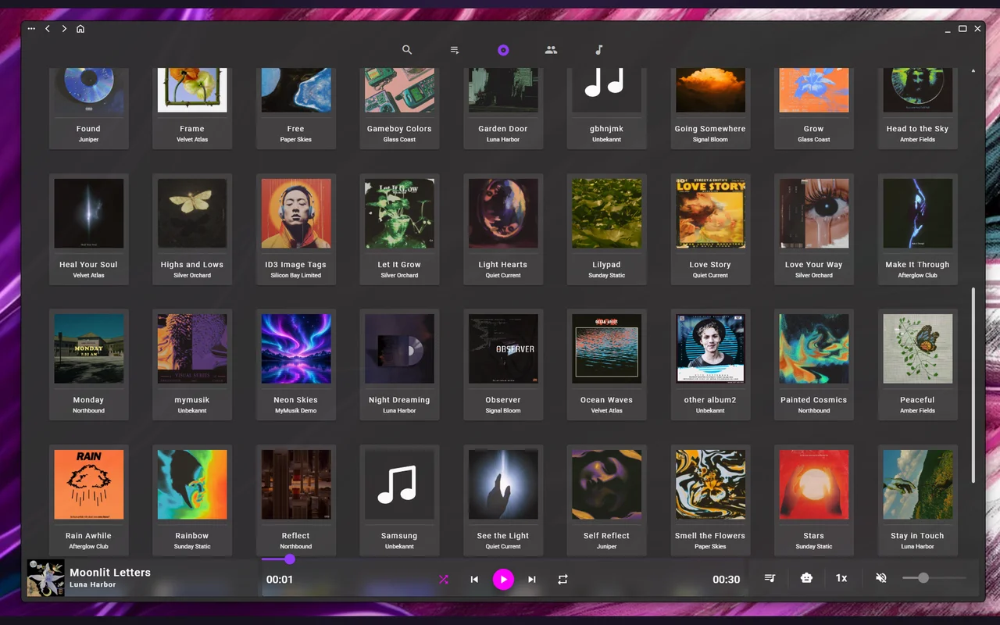
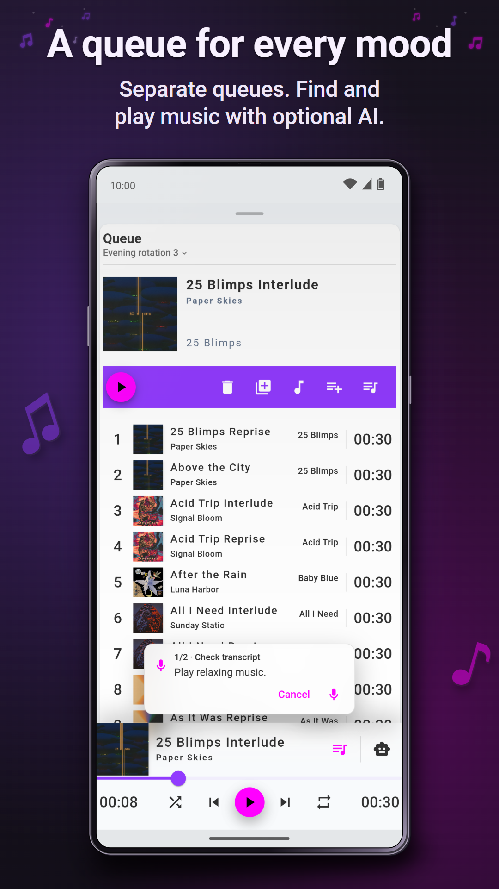

# MyMusik MCP

Ask Claude, Codex or another MCP client to find an album in your own music collection, queue a playlist or organize tracks. The connector runs on the computer that runs your MCP client. It talks to your open MyMusik app on the same computer or over your private network. You choose what it can do and when its access expires.

**Get MyMusik** · [Windows on the Microsoft Store](https://apps.microsoft.com/detail/9PHH0491K006) · [Android on Google Play](https://play.google.com/store/apps/details?id=com.shaggai.mymusik) · [Linux AppImage](https://mymusik.app/en/download/) · [MyMusik website](https://mymusik.app/)

**Get the connector** · [Release downloads](https://github.com/shagg-ai/mymusik-mcp/releases/tag/v0.1.0) · [Official MCP Registry](https://registry.modelcontextprotocol.io/v0.1/servers/io.github.shagg-ai%2Fmymusik-mcp/versions/latest) · [Pair and find your first albums](#pair-and-find-your-first-albums)

<!-- mcp-name: io.github.shagg-ai/mymusik-mcp -->

MyMusik is an offline music player and library manager for the files you own. Import your MP3, FLAC and WAV files, browse by album or artist, and keep separate queues for different listening sessions. Local playback is free and works without an account.

<p>
  
  
</p>

## What you can ask

### Import and edit audio

- **Import a folder.** “Import the audio files from my Rehearsals folder. When the import finishes, list the tracks that made it into my library and flag any files I need to review.”
- **Cut an intro.** “Cut the first eight seconds of count-in from my track ‘Friday rehearsal’.”
- **Extract a clip.** “Take 01:12 to 01:42 from ‘Friday rehearsal’ and save those 30 seconds as a new track called ‘Bridge idea’.”

Choose **Import manager** for import and audio-editing operations. Give MyMusik a path it can read on the device where the app is running. Cuts need editable local audio. To create and organize a new track in the same request, use **Custom** with write access to **Imports and files** and **Music library**.

### Organize your collection

- **Sort albums into folders.** “Create a MyMusik folder called ‘Live sets’ with a subfolder for each artist. Find the albums tagged ‘Live’ and add each one to its artist’s folder.” MyMusik folders group entries in your library.
- **Tag tracks in bulk.** “Add the ‘Practice’ tag to every track on my Friday rehearsal album. Keep its existing tags so I can still find it under ‘Live’.”
- **Fix metadata.** “Find tracks credited to ‘Paper Skies’ or ‘PaperSkies’. Show me both sets, then change the artist spelling to ‘Paper Skies’ on the tracks I choose.”
- **Build a playlist.** “Make a playlist called ‘Next rehearsal’ from tracks tagged ‘Practice’. Put ‘Bridge idea’ first and include each track once.”

Use **Read only** to search or preview the changes. Choose **Library editor** to save folders, tags, metadata and playlists.

### Play and export

- **Control the queue.** “Play ‘Next rehearsal’. Queue my Friday rehearsal album after it.” Choose **Remote playback**.
- **Export a playlist and its audio.** “Export ‘Next rehearsal’ as an M3U8 playlist. Also prepare a ZIP of its tracks as tagged MP3s so I can take the audio with me.” The M3U8 contains references to the tracks. The ZIP requires exportable audio, and your client needs to support saving the download.

To change permissions, apply the new settings in MyMusik, copy a fresh invitation, run `mymusik-mcp pair` again and reconnect your client. [MyMusik access presets and examples](https://mymusik.app/en/music-mcp-server/)

## Pair and find your first albums

1. Install MyMusik, add some music and keep the app running. If the app is on a different device, put both devices on the same private network and enable **Allow Remote Access** in MyMusik’s web server settings.
2. On the computer running your MCP client, install Python 3.10 or newer and run the following command. If you use a virtual environment, activate it first.

   ```sh
   python -m pip install https://github.com/shagg-ai/mymusik-mcp/releases/download/v0.1.0/mymusik_mcp-0.1.0-py3-none-any.whl
   ```

3. In MyMusik, open **Insights → Connect a device**. Select the shield, choose **Read only** and a session duration, then **Apply → Copy agent prompt**.
4. Run the pairing command below. At the hidden input, paste **only the invitation URL containing `#grant=`** from the copied prompt and press Enter. Each invitation works once.

   ```sh
   mymusik-mcp pair
   ```

5. [Connect your MCP client](#connect-your-mcp-client), then ask **“List three albums from my MyMusik library.”** Open **Albums** in MyMusik to compare the names.

When access expires, copy a fresh invitation, run `mymusik-mcp pair` again and reconnect or restart the server in your client. [Illustrated pairing guide](https://mymusik.app/en/music-mcp-server/)

## Connect your MCP client

**Codex.** With the installed `mymusik-mcp` executable on your PATH, run these commands and start a new local chat.

```sh
codex plugin marketplace add shagg-ai/mymusik-mcp
codex plugin add mymusik@mymusik-plugins
```

**Claude Code.** Clone this repository and start a local session with the bundled plugin. It uses `python` on your PATH and reads the session you paired above.

```sh
git clone https://github.com/shagg-ai/mymusik-mcp.git
cd mymusik-mcp
claude --plugin-dir ./plugins/mymusik
```

**Other local MCP clients.** If your client accepts MCP bundles, [download the MCPB](https://github.com/shagg-ai/mymusik-mcp/releases/download/v0.1.0/mymusik-mcp.mcpb) and open it in the client. For clients with an `mcpServers` configuration, use this configuration.

```json
{
  "mcpServers": {
    "mymusik": {
      "command": "mymusik-mcp",
      "args": ["stdio"]
    }
  }
}
```

If a desktop client cannot find the command, use the absolute path to the installed executable. For Codex, launch it from the activated environment or install the downloaded wheel with `pipx`, add the pipx applications directory to PATH and restart Codex. The command also defaults to stdio when called without arguments.

## Permissions and stored data

Pair under the operating-system account that runs your client. The connector saves the session in `%LOCALAPPDATA%/mymusik-mcp/connection.profile` on Windows using user-scoped DPAPI. On other systems it uses a private file with mode `0600` under `$XDG_CONFIG_HOME/mymusik-mcp` or `~/.config/mymusik-mcp`. Delete the profile to remove the saved session. Keep invitations and profiles private. Your selected MCP client receives the tool results.

To pair a second instance, pass the same `--profile PATH` to both `mymusik-mcp pair` and `mymusik-mcp stdio`. From a source checkout, you can also pair with `python plugins/mymusik/mymusik_mcp/cli.py pair`.

[MIT license](https://github.com/shagg-ai/mymusik-mcp/blob/main/LICENSE) · [Release validation](https://github.com/shagg-ai/mymusik-mcp/blob/main/VALIDATION.md)
